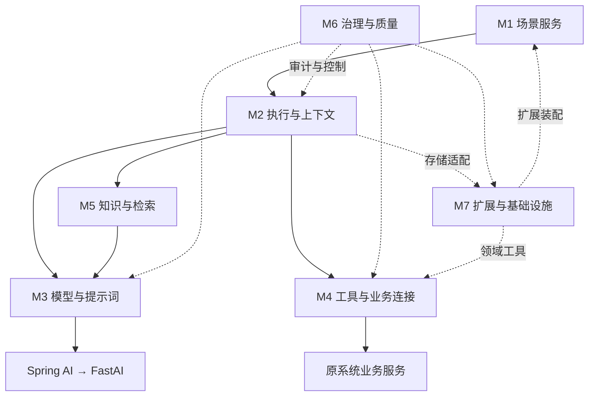

> 历史归档：2026-10-29 迁移。保留当时内容，不再更新；不得作为当前基线或新任务默认输入。

# 七模块能力地图

版本 0.5 · 2026-10-26 · 当前架构基线

## 1. 模块职责与进度

七模块表达逻辑职责，不等于七个微服务、Maven 模块或必建目录。模块按需求参与，简单场景不必经过所有能力。

| 编号 | 模块 | 核心职责 | 当前状态与边界 |
| --- | --- | --- | --- |
| M1 | 场景服务 | 能力调用、托管对话、场景定义、版本、注册选择、输入输出、结果交互 | 场景定义与管理需求完成；具体接入协议、页面交付、流式与结果联动待细化 |
| M2 | 执行与上下文 | Execution、Step、生命周期、简单处理/Workflow/Agent、会话、可信身份与参数上下文 | 下一专题；状态机、恢复等级、对象关系、上下文规则和执行器契约未确认 |
| M3 | 模型与提示词 | 提示词、版本引用、变量、模型适配、输出解析校验、流式及向量化基础 | 复用 Spring AI/FastAI；实际兼容性及具体契约待验证 |
| M4 | 工具与业务连接 | 工具契约、注册、授权、确认、幂等、调用、失败与结果核对 | 原系统保留业务事实与规则；工具及业务调用细节未设计 |
| M5 | 知识与检索 | 来源、加工、索引、检索、引用与更新 | 按实际需求启用，不因具备向量化而默认建设知识平台 |
| M6 | 治理与质量 | 审计、追踪、耗时/用量、限额、错误分类与评测 | 需要审计已确认；记录、留存及治理机制待细化 |
| M7 | 扩展与基础设施 | 领域装配、身份及业务适配扩展点、存储、命名空间、配置和健康检查 | 通用底座不反向依赖人力；装配与存储实现待设计 |

## 2. 协作图

图示运行协作，代码依赖经必要契约隔离。M7 中装配机制与领域内容分开；M6 消费运行信号，不替代执行状态存储。

## 3. 交叉职责

- M1 声明场景及依赖，M2 记录执行事实并推进流程，M3 加载提示词并处理模型输出。
- M1 的业务输入输出契约独立于模型响应格式；M3 提供解析校验机制。
- M1 声明允许工具，M2 决定调用时机，M4 强制授权、确认、幂等和审计边界，原系统执行最终业务校验。
- M2 管理会话和执行归属；原系统认证由可信链路传入，M7 提供适配，M4 按当前用户授权调用。
- M2 定义合法状态和存储需求，M7 实现存储，不自行决定状态转换。
- M5 的检索可预执行、作为流程节点或工具；实际证据来源与更新机制由该模块定义。

## 4. Spring AI 复用原则

模型与提示词、工具调用及检索基础按需复用 Spring AI；本框架补足业务场景、执行状态、领域扩展和治理。只在业务稳定契约、治理或替换需要时增加抽象，不逐类型复制 Spring AI。

代码组织建议见[架构说明书](08-architecture-guide.md)，讨论进度及下一步见[接续说明](06-discussion-roadmap.md)。
