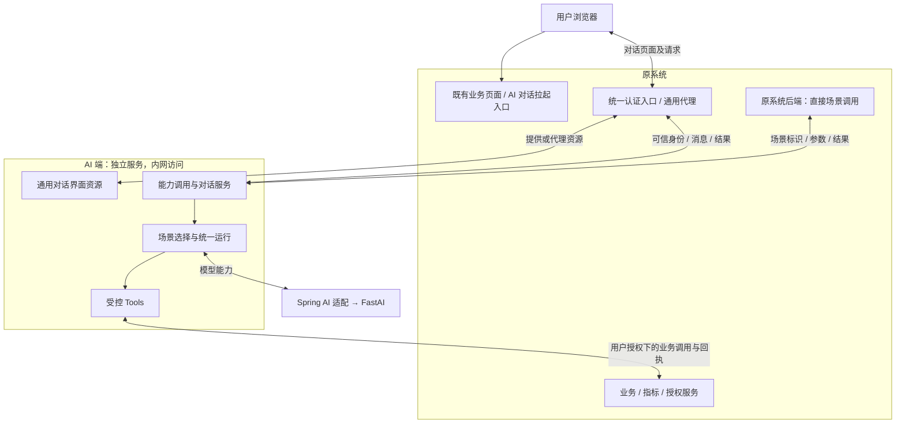
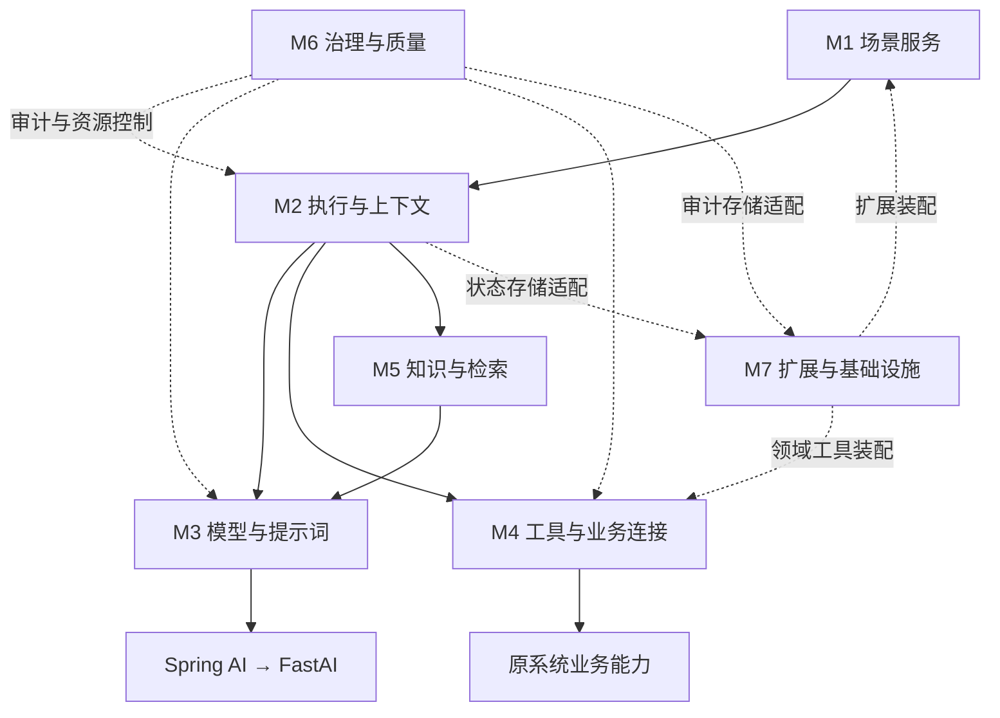
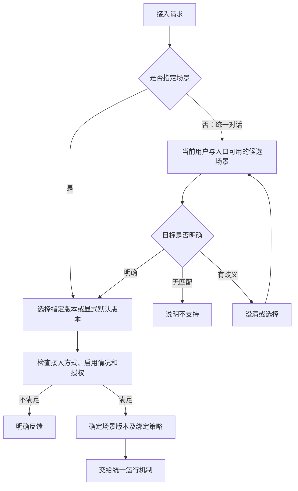

> 历史归档：2026-10-29 迁移。保留当时内容，不再更新；不得作为当前基线或新任务默认输入。

# 业务 AI 场景运行框架：架构设计说明书

版本 0.5 · 2026-10-26 · 协作者串讲版

本文说明项目整体思路，并以 M1 中“场景定义与管理”为案例展开需求级设计。框架定位、七模块职责、两端交互及 M1 的场景定义与管理需求已经确认；其余模块仅说明职责，具体契约和实现仍待专题讨论。文中的“模块”指逻辑职责，不代表独立微服务或 Maven 模块。当前仅有文档，无可运行实现。

## 1. AI 服务的角色定位与项目目标

### 1.1 角色定位

AI 服务是可共享给不同业务系统的“业务 AI 场景运行框架”。以人力系统为首个领域，通过场景将模型理解与生成能力、既有业务能力和受控执行连接起来。

原系统和 AI 端构成两个系统边界。原系统继续拥有业务事实、规则、权限和审批；AI 端负责理解目标、补齐参数、组织交互、执行场景并形成结果。用户无需了解内部采用简单处理、Workflow 还是 Agent。

技术基线为独立 AI 服务，在 Spring AI 之上组织场景，通过 FastAI 取得对话和向量化能力，先按 OpenAI 兼容入口接入。原人力系统为 Spring Boot/JDK 8，新服务使用独立运行时，不把新依赖直接引入原系统。具体版本组合尚未冻结，协议能力仍需实际验证。

### 1.2 项目目标与边界

| 目标 | 期望效果 |
| --- | --- |
| 场景化提供 AI 能力 | 原系统通过场景标识调用，无需管理提示词或执行策略 |
| 降低多轮对话接入成本 | AI 提供通用对话界面，原系统拉起、认证并通用代理，无需逐场景开发对话流程 |
| 使用真实业务能力 | 通过受控 Tools 获取数据或执行动作，结果依据原系统事实和回执 |
| 统一运行与治理 | 三种策略共用执行、权限、审计等机制，避免每个场景自行实现 |
| 支持其他领域复用 | 移除人力扩展后，通用底座仍能承载其他领域场景 |

后续以问数、请假、低代码智能体高代码迁移三个 Demo 验证方案，具体实现深度尚未全部确认。当前不建设完整人力业务前端、流程设计器、模型供应商平台、任意 SQL 问数或全自动审批；不生成业务代码。

### 1.3 两种接入方式

**能力调用**：原系统以场景标识及尽可能完整的一次性参数发起请求。AI 校验输入，可使用场景允许的 Tools 获取缺失事实，整合后完成模型加工，将业务结果返回原系统。仍缺必要信息时明确反馈，不自动切换为对话。

**托管对话**：原系统拉起 AI 提供的对话界面，交接可信身份和必要业务背景。所有对话请求经原系统代理，AI 承接意图识别、多轮追问、候选选择、确认及结果展示；信息充分后执行场景，结果经代理返回。可以指定场景进入，也可以先识别目标。

两者共用场景定义及执行机制。托管对话是交互方式，不是新的执行策略。当前目标完成不等于必须关闭整个会话；对话理解阶段本身也可以使用模型。

### 1.4 原系统与 AI 端职责

| 事项 | 原系统 | AI 端 |
| --- | --- | --- |
| 访问与身份 | 复用登录态，统一认证并代理请求，提供可信身份 | 不建设独立账号登录体系，接入可信身份并校验对话和结果归属 |
| 对话界面 | 提供拉起入口和通用代理 | 提供界面并承接后续对话 |
| 业务事实 | 提供数据、口径、规则和真实业务回执 | 经 Tools 获取并组织信息，不编造事实 |
| 权限及写入 | 业务服务保留最终授权、规则校验、写入和审批 | 约束场景和工具范围，执行确认及受控调用 |
| 直接能力调用 | 提供输入，使用返回结果 | 按契约加工并返回 |

AI 页面经原系统入口提供或代理，浏览器不直接访问内网 AI 服务。页面部署、可信身份协议、代理技术、流式转发和页面刷新等联动方式留待后续设计。信任原系统认证不等于放弃 AI 对话归属校验，也不代表 Tools 可以绕过业务授权。

## 2. 当前架构与七模块职能

### 2.1 系统边界图



图中的用户浏览器是访问媒介，不是第三个业务系统。AI 提供界面，不要求 AI 服务对浏览器直接暴露。Tools 反向调用原系统业务服务，与原系统代理对话消息是不同方向的协作。

### 2.2 七模块内部逻辑架构



七模块作为当前唯一的一级架构。场景定义与管理属于 M1，其需求已完成；M1 的具体接入交互仍待细化，下一专题为 M2。

### 2.3 七模块职责与进度

| 编号 | 模块 | 核心职责 | 当前状态与边界 |
| --- | --- | --- | --- |
| M1 | 场景服务 | 能力调用、托管对话、场景定义、版本、注册选择、输入输出、结果交互 | 场景定义与管理需求完成；具体接入协议、页面交付、流式与结果联动待细化 |
| M2 | 执行与上下文 | Execution、Step、生命周期、简单处理/Workflow/Agent、会话、可信身份与参数上下文 | 下一专题；状态机、恢复等级、对象关系、上下文规则和执行器契约未确认 |
| M3 | 模型与提示词 | 提示词、版本引用、变量、模型适配、输出解析校验、流式及向量化基础 | 复用 Spring AI/FastAI；实际兼容性及具体契约待验证 |
| M4 | 工具与业务连接 | 工具契约、注册、授权、确认、幂等、调用、失败与结果核对 | 原系统保留业务事实与规则；工具及业务调用细节未设计 |
| M5 | 知识与检索 | 来源、加工、索引、检索、引用与更新 | 按实际需求启用，不因具备向量化而默认建设知识平台 |
| M6 | 治理与质量 | 审计、追踪、耗时/用量、限额、错误分类与评测 | 需要审计已确认；记录、留存及治理机制待细化 |
| M7 | 扩展与基础设施 | 领域装配、身份及业务适配扩展点、存储、命名空间、配置和健康检查 | 通用底座不反向依赖人力；装配与存储实现待设计 |


### 2.4 四个核心概念与三种策略

| 概念 | 含义 |
| --- | --- |
| SceneDefinition | 一个版本的能力定义：能做什么、需要什么、产生什么、采用什么策略 |
| Execution | 一次业务目标的实际执行，记录采用版本、输入、步骤、结果等事实 |
| StepExecution | 执行中的可观察步骤，按策略记录 |
| Conversation | 可选的交流上下文，可关联多个业务目标，不是业务状态的唯一存储 |

以上是逻辑概念，不是已冻结的 Java 类或数据库实体。

| 策略 | 使用定位 |
| --- | --- |
| 简单处理 | 多数场景：输入预处理 → 单次主要模型调用 → 输出校验/转换，不要求声明 DAG |
| Workflow | 少量预定义 DAG：确定节点、分支、并行和汇聚，可调用模型、工具和确定性处理 |
| Agent | 极少量受控动态执行：在允许工具、知识、预算及终止条件内选择路径 |

策略在研发时与场景绑定。缺参、确认、等待等交互需求不自动改变策略。确定性工具补充可属于输入预处理；需要模型反复选择工具时，应研发绑定相应 Workflow/Agent，具体执行机制留到 M2/M4。

## 3. M1 场景服务案例精讲：场景定义与管理

本章为已确认的需求级逻辑设计，用于说明可观察行为及职责边界，不冻结接口字段、类结构、表结构或技术选型。完整编号需求见 [M1 需求基线](07-scene-requirements.md)。

### 3.1 职责与非目标

M1 的场景定义与管理负责定义、注册和选择可执行的业务 AI 能力。它回答：这个场景是什么、接受什么、返回什么、使用哪种策略、允许使用哪些依赖、当前是否可用。

场景定义不负责保存对话进度、执行状态、工具回执或确认记录；不负责实现原系统接口；不建设场景管理后台、流程设计器、在线热更新或工具市场。

### 3.2 最小场景描述

| 内容 | 需求含义 |
| --- | --- |
| 稳定标识与版本 | 标识业务能力及确定的一份定义；名称不代替标识 |
| 名称、用途与适用范围 | 用于开发者理解和自然语言选择，描述不适用情形及必要表达示例 |
| 业务输入契约 | 信息含义、必填性、基本类型、约束及允许来源 |
| 业务输出契约 | 最终结果的内容和约束，与追问、确认和失败说明分开 |
| 策略与执行定义 | 绑定简单处理、Workflow 或 Agent 及对应实现引用 |
| 按需依赖 | 提示词版本、允许工具及用途、知识范围，无依赖不强制空配置 |
| 接入与交流要求 | 支持能力调用或托管对话、是否需要会话或多轮 |
| 可用范围 | 启用情况、是否参与自然语言发现及授权条件 |

默认版本与注册信息属于装配管理。用户本次参数、工具查到的余额、是否已确认和当前执行步骤均不是场景定义内容。

策略、交互方式和自然语言发现是不同维度：支持托管对话不代表必须自动发现，使用简单处理也不代表不能先追问参数。

### 3.3 注册、版本和停用

1. 领域扩展随代码/配置装配场景，不要求首期实现在线注册。
2. 同一标识与版本唯一，冲突不能静默覆盖；检查必需依赖并报告定义错误。
3. 同一场景可以按兼容需要装配多个版本，不强制首期并存。
4. 只提供场景标识时使用环境显式指定的默认版本；指定版本则精确选择，不自动降级或取最大版本。
5. 已使用的版本不原地覆盖；策略、提示词、契约或依赖绑定改变，通过新版本表达。
6. 一次业务目标采用版本后保持不变；同一对话中的新目标可重新选版本。
7. 不参与自然语言发现与禁止新执行分开：隐藏场景仍可按授权指定调用，停用场景不接受新目标。

停用后的已有执行能否继续，由 M2/M4 细化，不自动迁移版本，也不因保持版本而绕过实时授权。注册错误是否阻止整服务启动、非执行展示元数据如何更新留到后续实现设计。

### 3.4 场景选择流程



明确指定场景无需先经模型识别。模型选中场景不构成授权。场景内回复优先结合当前目标理解；明确提出新目标时识别切换，涉及未完成业务动作时不能悄悄继续提交旧目标，具体执行处置留到 M2。

### 3.5 输入补充与输出规则

输入来源包括用户表达、原系统结构化参数、可信身份上下文和 Tools 获取的业务事实。最终必需的信息不一定都要在首次请求提供。

| 情形 | 需求行为 |
| --- | --- |
| 明确调用参数充分 | 整合加工，按契约返回结果 |
| 缺少可查询事实 | 在允许 Tools 中寻找补充能力，授权调用后使用真实数据 |
| 工具补充后仍缺参 | 直接调用返回缺失说明；托管对话可以继续追问，不编造用户意愿 |
| 身份与用户自述冲突 | 采用可信身份，文本不能提升权限 |
| 文本、页面背景和参数矛盾 | 对影响业务结果的冲突先澄清，不让模型任意覆盖 |
| 输出不合契约 | 不作为成功结果返回；修复和重试机制由 M3/M2 后续设计 |
| 原系统业务请求结果不明 | 不宣称成功或失败，不盲目重复写入，具体核对由 M4/M2 细化 |

业务结果可以是摘要、数据、草稿或问答；追问、确认、失败及关联信息由通用交互机制表达。托管对话由 AI 界面展示并采集，直接能力调用由原系统使用返回结果。导航、预填和刷新原系统页面的联动协议尚未冻结。

### 3.6 工具依赖的职责边界

| 层次 | 定义什么 | 负责方 |
| --- | --- | --- |
| 场景定义 | 本场景允许哪些工具、业务用途和范围 | M1 |
| 工具定义及调用控制 | 参数结果、授权、确认、幂等、失败处理 | M4，后续专题 |
| 领域业务适配 | 原系统接口映射、业务语义及身份接入 | M7，后续专题 |
| 真实业务实现 | 数据、计算口径、规则、写入与审批 | 原系统 |

声明可用工具是能力上限，不代表自动执行或获得权限。Workflow 的调用时机由流程定义，Agent 在允许范围内选择，均经过相同受控工具边界。知识范围和提示词同样通过引用表达，实际版本/证据由相应组件与运行时记录。

### 3.7 案例一：文本摘要，讲清最小场景

以下是文档推演，不是已实现功能或完整接口样例。

| 描述项 | 示例 |
| --- | --- |
| 标识与版本 | common.text-summary / v1，示例命名 |
| 输入 | 正文必需，摘要长度可选 |
| 输出 | 摘要文本 |
| 策略 | 简单处理，绑定确定执行定义与提示词版本 |
| 依赖 | 无业务工具、无知识检索 |
| 交互 | 支持能力调用和托管对话；直接调用无需会话 |
| 发现 | 可参与统一对话目标识别 |

直接路径：原系统提供标识和正文 → 选择定义 → 校验 → 单次主要模型加工 → 输出校验 → 返回摘要。缺正文且无补充来源时返回缺失说明。

对话路径：用户表达“帮我总结” → AI 识别摘要场景 → 追问正文 → 用户补充 → 使用同一场景的绑定策略加工 → 经代理呈现结果。交互形式不同，不需要临时切换为 Agent。

### 3.8 案例二：请假余额，讲清真实数据与工具补充

该案例说明需求边界，不新增首批 Demo 承诺，也不定义实际工具接口。

原系统指定余额查询场景及查询条件 → AI 从可信身份确定查询主体 → 通过场景允许的余额工具查询 → 原系统返回真实余额及可提供的单位、适用时间 → AI 组织结果并返回原系统。

在此过程中，M1 只声明业务输入输出、策略及余额工具依赖。余额如何计算由原系统决定，工具如何传播当前用户身份由 M4/M7 设计。如果查询他人，必须经过既有业务授权，不能仅依据用户文字。

### 3.9 验收与异常检查

| 检查 | 可观察的合格行为 |
| --- | --- |
| 注册冲突 | 不静默覆盖，错误可定位 |
| 依赖缺失 | 对应定义不可用，原因明确；不依赖运行后猜测 |
| 默认版本 | 明确唯一，无指定版本时可追溯选择依据 |
| 版本变更 | 已开始业务目标不被中途换版 |
| 缺参与歧义 | 工具补充、追问或缺失说明有明确路径 |
| 路由与权限 | 无匹配、多匹配、隐藏、停用和无权访问不能混同 |
| 外部失败 | 不返回虚构业务成功，不自动盲重试写入 |
| 去人力化 | 不加载 HR 扩展，仍能装配通用摘要场景 |

这些是需求验收依据，尚无实际联通或运行测试证据。

### 3.10 场景定义专题完成范围及后续衔接

M1 中场景定义与管理的需求分析已收口：最小定义、注册版本、输入输出、工具引用和选择边界形成基线。详细接口文档及实现设计应以这些行为为依据。

后续先讨论 M2 的执行生命周期、上下文和策略；M3 细化提示词与模型契约，M1 补齐接入交互；其余模块按 Handoff 路线推进。不以本说明书提前冻结这些模块。

## 4. 面向 Spring AI 的代码组织建议

七模块架构已确认。本节是为后续工程准备的目录与依赖建议，尚未冻结代码结构、Maven 拆分或具体 Spring AI API 版本；当前不创建工程和占位目录。

### 4.1 单工程起步，按能力分包

建议初期使用一个 Spring Boot 后端工程、一个启动入口。以七模块对应的能力包组织通用底座，把人力实现放在独立扩展包。不要同时铺设七个 Maven 模块及每模块完整的多层骨架。

```text
项目根目录/
├── docs/                           需求与架构材料
├── src/main/java/<项目包>/
│   ├── AiApplication               启动入口（示意名）
│   ├── framework/
│   │   ├── scene/                  场景服务：接入、定义、注册和选择
│   │   ├── runtime/                执行与上下文：生命周期、策略、会话
│   │   ├── model/                  模型与提示词：Spring AI 接入及输出处理
│   │   ├── tool/                   工具与业务连接：通用契约和受控执行
│   │   ├── knowledge/              知识与检索：按实际需求出现
│   │   ├── governance/             治理与质量：审计和资源控制
│   │   └── platform/               扩展装配、存储及环境配置
│   └── extensions/
│       └── hr/
│           ├── scene/              人力场景及流程定义
│           ├── tool/               人力业务工具实现
│           ├── client/             原系统业务与授权服务适配
│           └── config/             人力扩展装配
├── src/main/resources/
│   ├── application.yml             配置示意，实际文件后续建立
│   └── prompts/                    提示词资源，按领域/场景组织
└── web/                            AI 对话前端源码，技术栈与交付待定
```

目录只表示未来组织方式，不要求所有目录首期存在。知识能力没有实际需求时不建空实现。前端源码可独立构建，静态资源最终随后端打包或由原系统入口代理等方式后定，不因此增加第三个业务系统。

七模块的“扩展与基础设施”包含通用装配机制；extensions/hr 是该机制装配的领域内容，不属于通用底座。将二者在架构上归为一类，不意味着把业务实现混入 platform。

### 4.2 包内按需要分层

先按能力定位代码，再在复杂能力内部增加必要分层，不强制每个包都建立 controller/service/manager/repository 等目录。

以 scene 为例，后续可按实际复杂度细分为 api（外部交互与 DTO）、application（场景调用协调）、definition（定义与契约）、registry（注册及版本解析）。runtime 可按 execution、strategy、context 分组。以上均为目录候选，不是预定类清单。

边界要求：外部 DTO 不直接充当持久化实体；定义不保存执行事实；协调逻辑不堆在 Controller；身份认证适配不变成独立账号体系。只在确有存储、远程调用或替换需求时增加接口和适配器，不为每个实现创建一对接口/实现类。

### 4.3 依赖约束

- 场景接入通过稳定的运行命令/结果契约使用运行时；运行时通过执行所需的场景定义，不反向依赖场景 Controller 或注册实现，避免 scene 与 runtime 实现循环依赖。
- model、tool、knowledge 提供各自能力，依赖治理与执行信息时采用必要的稳定契约；治理消费运行信号，避免所有模块互调治理实现。
- 存储访问接口由拥有业务状态的能力定义，platform 提供技术实现并在启动时装配；运行时不直接依赖具体数据库/Redis 实现。
- extensions/hr 可依赖通用契约及 Spring AI 扩展点；framework 不导入人力类型、业务枚举或原系统实体。
- Spring 配置负责实现装配，不把 Bean 动态查找当作绕过模块边界的方式。不加载 HR 扩展后仍能启动通用摘要能力作为抽取检验，尚未实现。

少量真正跨模块的稳定契约可以按需要抽取，但不提前建设庞大 core/common/util 包。接口拆分与循环依赖检查留到代码设计时落实。

### 4.4 Spring AI 的复用方式

模型与提示词模块负责集中装配和使用 Spring AI。官方提供 ChatClient 等模型交互接口及工具调用机制，本项目围绕它们补充场景、执行与治理，不再建立一套与其逐类型对应的 AI SDK。参考 [ChatClient 文档](https://docs.spring.io/spring-ai/reference/api/chatclient.html)和[工具调用文档](https://docs.spring.io/spring-ai/reference/api/tools.html)。页面会演进，工程阶段按冻结版本验证。

| 位置 | 建议做法 |
| --- | --- |
| 模型与提示词 | 直接复用模型客户端、模板和输出处理基础；集中管理 FastAI 接入与所需差异 |
| 工具与业务连接 | 复用工具描述/回调机制；业务调用仍强制经过本框架授权、确认、幂等与审计边界 |
| 执行与上下文 | 业务执行和会话归属由本框架管理；模型历史增强机制不代替业务执行状态 |
| 知识与检索 | 按需复用检索基础，数据来源、权限范围和证据生命周期仍由项目明确 |
| 领域扩展 | 可使用必要的 Spring AI 工具扩展点，不要求所有 Spring AI 类型一律隔离封装 |

外部请求 DTO、场景业务契约和业务执行状态不绑定模型供应商类型；模型/工具适配处允许直接使用 Spring AI 类型。只有业务稳定性、治理或替换需要时才新增抽象。

### 4.5 何时考虑 Maven 拆分

先用包边界验证结构。当通用底座确需被第二个业务工程复用、领域扩展需要独立依赖管理或发布时，再考虑抽出底座、领域扩展和启动装配工程。七个一级模块不自动对应七个制品；不提前创建 starter、插件框架或完整自动配置产品。

## 参考与维护

- [需求范围](01-requirements.md)
- [架构基线](03-architecture.md)
- [能力地图](05-capability-map.md)
- [讨论路线与进度](06-discussion-roadmap.md)
- [M1 场景需求基线与编号条目](07-scene-requirements.md)

本说明书用于串讲；编号需求以 M1 需求基线为准，后续共识应同步更新需求基线、当前决策及 Handoff。
