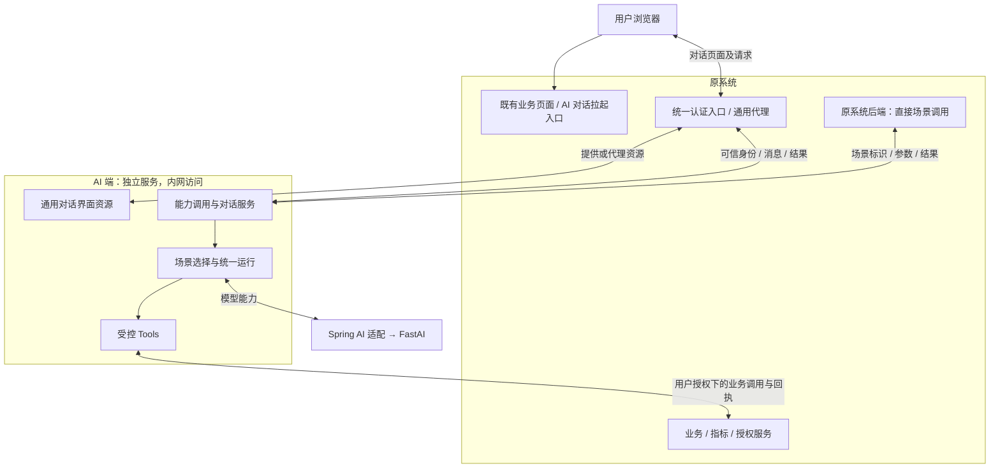
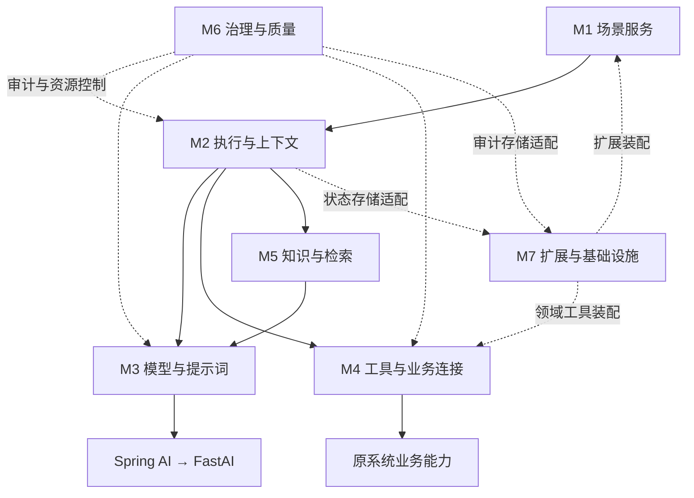
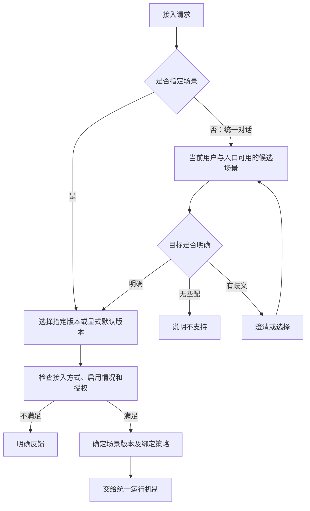

# Astra Core · 需求范围与技术架构设计说明书

整理版本 0.7 · 2026-10-29 · 业务共识继承 0.5；协作规范升级，未新增业务决策。

这是唯一维护的业务说明书。在 main 上表示团队认可的当前基线；工作分支上的修改是候选稿，未经 PR 最终确认与合并不成为团队基线。来源提交由任务 Handoff 记录，不能按文件修改时间判断版本。

状态：当前仅需求分析和需求级架构设计，无业务代码、构建工程、运行 Demo 或真实联通证据。M1 仅场景定义与管理需求完成；M1 接入交互细节和 M2—M7 仍待细化。

阅读口径：明确标为“已确认”的内容构成约束；“建议”“草案”“候选”和示例中的状态/字段不能视为冻结接口、类或存储。推演与验收样例不代表已实现。相邻章节的摘要不替代编号需求，明确确认的 M1 约束以第 4 章为准；发现实质矛盾时提出问题，不自行升级建议。

目录：

1. [目标、范围与总体需求](#scope)
2. [场景分类与验证样例](#scenarios)
3. [总体技术架构](#architecture)
4. [M1 场景定义与管理](#m1)
5. [接入与基础设施建议](#integration)
6. [未来工程组织建议](#code-organization)
7. [可行性与决策](#decisions)
8. [依赖、验证及待确认项](#open-items)

本文可独立阅读，不需要加载历史材料。[当前 Handoff](../handoff/current.md) 只提供工作指引，不另存业务结论。协作规则见根目录 AGENTS.md 和 README.md。

<a id="scope"></a>

## 1. 目标、范围与总体需求

### 1.1 项目定位

建设承载业务 AI 场景的运行框架，首先为完整的现有人力资源系统增加独立 AI 微服务，在既有功能与权限范围内扩展自然语言交互、业务执行、问数及智能内容处理。微服务同时承担通用 AI 服务底座的验证任务：去除人力模块后，应能通过其他领域扩展接入新业务。

目标分为两部分：通用部分解决会话、编排、工具执行和运行治理；人力部分解决业务语义、参数、场景流程与现有系统适配。

已确认的总体能力与职责见[七模块能力地图](#architecture)，下一轮讨论入口见[讨论路线](../handoff/current.md)。本文功能条目是需求基线，具体字段、状态、验收细节与实现范围待逐项讨论。

### 1.2 已确认事实

| 事项 | 当前结论 |
| --- | --- |
| 现有人力系统 | 企业级 Spring Boot、JDK 8，功能和权限体系完整 |
| 新服务 | 独立微服务，可以使用 Spring AI |
| FastAI（外部模型依赖） | 由用户另一项目维护，可认为已具备大模型对话和向量化能力 |
| 模型接入 | 先按 OpenAI 标准协议对接，模型厂商与选型不在本项目讨论范围 |
| 首批场景 | 问数、请假、传统低代码智能体迁移至高代码，各一个 Demo |
| 基础设施 | 数据库、Redis 可复用原系统，也保留独立配置新实例的能力 |
| 数据来源 | 现有人力系统 |
| 治理 | 需要日志审计；本轮不新增模型脱敏、租户隔离需求；既有人力权限仍适用 |
| 当前成果 | Markdown 需求与架构可行性材料，供思路碰撞，不按正式交付件组织 |

### 1.3 系统边界

| 系统 | 负责 | 边界 |
| --- | --- | --- |
| 原系统 | 登录身份、认证代理、对话拉起、原业务规则、审批、指标定义与数据 | 继续作为业务事实来源 |
| 人力 AI 微服务 | 理解需求、澄清参数、选择场景、编排、工具执行控制、结果组织和审计 | 不自行改变业务规则或计算口径 |
| FastAI（外部模型依赖） | 统一 AI 能力接入，对话与向量化 | SDK 内部协议、模型选择与网关适配由其维护 |

传统菜单与原业务链路继续存在。AI 可以返回导航，也可以经授权调用业务接口。服务通过接口复用业务能力；复用数据库基础设施不等于直接访问原业务表。

### 1.4 当前阶段范围

包含：需求边界、场景分类、分层架构、通用与领域组件划分、三类 Demo 设计、接口契约草案、审计与异常原则、可行性分析和后续问题。

暂不包含：可运行代码、实际 Demo、完整人力业务 UI、模型训练或选型、FastAI 内部改造、完整低代码平台、全量场景迁移、任意 SQL 问数、全自动审批、生产部署和容量承诺。

知识检索、文档生成、多模态、复杂多 Agent 协作等列入扩展分类，不自动成为首批实现范围。

### 1.5 功能需求

| 编号 | 需求 | 后续 Demo 可观察结果 |
| --- | --- | --- |
| F01 | 同时支持明确场景请求和自然语言路由 | 指定场景可直达；不明确请求能澄清或返回不支持 |
| F02 | 管理会话与多轮参数 | 缺参数可追问；不同用户会话不可串用 |
| F03 | 区分可信身份上下文与用户文本 | 用户自述角色、组织不能覆盖服务端上下文 |
| F04 | 执行受控业务工具 | 参数校验、授权、超时、调用次数和错误转换可检查 |
| F05 | 支持结构化结果及可选流式说明 | 数据、导航、待确认动作与文本能够区分 |
| F06 | 支持问数 | 指标、组织、时间澄清后调用既有指标接口，返回值与口径可追溯 |
| F07 | 支持请假 | 表单引导与对话代办可分步演进；业务服务保留最终校验和审批 |
| F08 | 支持存量智能体高代码迁移 | 提示词、流程、工具和输出能版本化，具有迁移前后对比样例 |
| F09 | 支持审计 | 请求、场景版本、AI 调用、工具调用与最终结果能通过 traceId 关联 |
| F10 | 支持领域插件式扩展 | 新领域无需修改通用底座的领域分支代码 |
| F11 | 支持基础设施配置切换 | 可配置共享或独立数据库、Redis；AI 状态有独立命名空间 |
| F12 | 对接对话与向量化 | 对话参与 Demo；向量化定义接入契约，按场景需要使用 |
| F13 | 以 Scene 对外提供能力，内部使用简单处理、Workflow、Agent 策略 | 大多数单次模型场景无需声明 DAG；策略共用执行与治理契约 |
| F14 | 区分可选会话、场景执行与执行步骤 | 可无会话执行，同一会话可关联多次执行 |
| F15 | 分离策略与生命周期 | 各策略可按需等待输入或确认；具体状态和恢复等级待定 |

#### 1.5.1 已确认的对话接入边界

保留场景能力调用，同时提供 AI 通用对话界面供原系统拉起。原系统允许简单改造或实现通用代理，统一负责用户认证和访问入口；页面及对话请求经原系统入口访问，AI 服务保持内网访问。AI 不建设独立账号登录体系，接入原系统可信身份，并校验对话与执行结果归属。AI 承接多轮交互，按需通过 Tools 使用原系统业务能力；原系统保留最终业务授权与规则。具体代理、身份协议和界面联动方式待设计。详见[场景需求分析](#m1)。

### 1.6 质量与运行需求

- 业务正确性：指标数值由现有服务提供；提交成功以业务回执为准；缺证据时不编造结果。
- 权限：入口校验、工具可用性控制、下游业务授权共同构成链路；模型不承担授权决策。
- 可靠性：配置超时、最大工具轮次、并发与输出限制；模型异常与业务异常分别归类。
- 写入一致性：写操作需要确认和幂等；超时后先查状态，不能盲目重试。
- 审计：记录操作者、场景与版本、时间、工具、状态、耗时、业务回执、模型用量（可获取时）；不得记录凭证。提示词和原始报文是否完整留存及保留期限待讨论。
- 可观测性：能区分模型耗时与业务耗时，记录错误率和调用量；未知用量显示未知。
- 性能：响应时间、并发量、会话规模与审计保留量待采样后确定，不预设没有依据的 SLA。
- 可维护性：场景配置、提示词、工具和评测样例应具备版本标识。

### 1.7 架构与需求细化范围

七模块职责划分已确认。按模块逐步补足职责/非目标、需求清单、核心对象与生命周期、契约、主流程与异常、扩展点、Spring AI 复用边界、验证样例及待定事项。不提前冻结完整表结构、Java 接口或中间件选型。

简单处理为主，Workflow 为少量预定义 DAG，Agent 为少量受控动态执行；RAG 按需组合，不限定为 Agent 专用。当前不承诺自由 SQL 问数、完整流程设计器或完整知识平台。

### 1.8 阶段推进

当前文档阶段：形成可讨论的需求、分类、架构与验证计划。

后续工程阶段建议：先建立独立服务和通用底座最小闭环，再接入三类 Demo；业务接口未就绪时使用明确标识的模拟适配器，模拟成功不算实际业务联通。

Demo 验证后再决定通用脚手架抽取、场景扩展和生产治理的投入范围。

<a id="scenarios"></a>

## 2. 场景分类与验证样例

### 2.1 分类原则

不把领域、能力类型和技术来源放进同一个互斥列表。一个请假场景可能同时具有导航、查询和交易能力；一个迁移的智能体可能实际属于内容生成或知识问答。

场景由一个可版本化的业务目标定义，Agent 是实现该目标的一种方式；不要求每个场景创建一个 Agent，也不默认使用多 Agent。

### 2.2 多维分类

| 维度 | 候选值 | 用途 |
| --- | --- | --- |
| 领域 | 人事、薪酬、招聘、外包、数智人力、其他 | 归属与领域组件选择 |
| 能力类型 | 导航引导、业务查询、指标问数、交易办理、内容理解/生成、知识检索问答、复合流程 | 确定所需组件与执行约束 |
| 来源 | 新建、低代码迁移、既有服务封装 | 记录迁移与兼容要求 |
| 交互方式 | 单轮、多轮、页面辅助、后台任务 | 决定会话与输出形式 |
| 执行策略 | 简单处理（单次模型调用）、Workflow（DAG）、Agent（受控动态执行） | 简单处理占多数，其他策略按实际需求使用 |
| 副作用 | 只读、生成草稿、业务写入 | 确定确认、幂等与重试策略 |
| 执行方式 | 同步、流式、异步 | 决定任务生命周期与结果获取 |

首批只验证三类 Demo 覆盖的能力。分类为扩展预留位置，不意味着所有组合都要开发。

### 2.3 能力类型与组件复用

| 类型 | 示例 | 复用能力 | 领域专属内容 |
| --- | --- | --- | --- |
| 导航引导 | 打开请假页 | 意图、槽位、导航结果 | 菜单标识、可用权限 |
| 业务查询 | 查询请假余额 | 工具、参数校验、结果格式 | 余额规则与接口 |
| 指标问数 | 本季度本机构离职率 | 澄清、指标解析、结果解释 | 指标编码、组织含义、统计口径 |
| 交易办理 | 提交请假 | 确认、幂等、状态核对 | 假别、时长规则、审批入口 |
| 内容理解/生成 | 便函草稿、会议纪要 | 提示词、结构化输出、校验 | 具体模板、内容规范；是否对应存量场景待核实 |
| 知识检索问答 | 制度问答 | 切分、向量化、检索、引用 | 知识来源与可访问范围；后续候选 |
| 复合流程 | 查询后生成报告并发起流程 | 状态、步骤、补偿与人工节点 | 业务流程；后续候选 |

向量化仅将文本转为向量，不等于完成知识库；检索还需要来源、分块、索引、更新和引用机制。无检索需求时不强制引入向量数据库。

#### 2.3.1 架构共识对场景的约束

场景以统一 Scene 契约对外暴露。简单处理不强制声明 DAG、启用会话或配置恢复；Workflow 节点可调用模型、工具或确定性处理，Agent 可作为局部步骤。会话、Execution 和 Step 分开建模。

以下 Demo 是架构验证样例，不是底座完整范围。问数初期建议受控指标流程，后续可采用 Tool + RAG 的探索式 Agent；这不自动引入自由 SQL。详见[架构基线](#architecture)。

### 2.4 Demo 1：离职率问数

目标：用自然语言查询一个已定义指标，验证澄清、授权范围、业务查询和可信解释。

推荐流程：请求 → 确定离职率指标 → 澄清时间与机构 → 从可信上下文解析允许范围 → 调用指标 Tool → 结构化返回数值、单位、统计区间、组织、口径与数据时间 → 生成解释。

输入示例：“本季度本机构离职率是多少？”

约束：本季度以业务时区和日历确定；“本机构”由现有身份体系解析；不自行设计离职率公式，不生成自由 SQL。数值主体来自 Tool 结果，解释不得改变数值。

待接入契约：指标编码、机构编码、开始/结束时间、授权上下文；输出值、单位、实际范围、口径版本及更新时间。

验证样例：参数完整、缺时间、机构歧义、越权机构、无数据、下游超时、业务值与文本一致。Demo 通过意味着结果可追溯且失败可解释，不代表已覆盖全部指标。

### 2.5 Demo 2：请假

目标：验证多轮业务参数收集、页面引导及受控业务写入，复用原有校验与审批。

建议采用两级验证，实施深度待确认：

1. 引导：理解请假需求 → 补齐可获取参数 → 返回允许访问的请假页面与预填字段。
2. 代办：收集假别、起止时间等 → 调用原服务预校验（如具备）→ 返回待确认摘要 → 用户确认 → 校验确认状态与参数版本 → 幂等提交 → 返回业务单号和审批状态。

确认必须绑定具体动作与参数版本；确认后修改参数，需要重新确认。取消、过期或其他用户的确认不能提交。

建议状态：COLLECTING → AWAITING_CONFIRMATION → EXECUTING → SUCCEEDED / FAILED / UNKNOWN；另有 CANCELLED / EXPIRED。UNKNOWN 表示业务请求结果不明，应查业务状态而不是直接重新提交。

模型负责理解日期表达，确定性代码结合业务日历处理日期、时区和时长；最终规则仍由原服务校验。

验证样例：缺日期、起止颠倒、假别不支持、取消、确认后改参数、重复确认、权限不足、余额不足、提交超时与状态核对。模型不能虚构已审批结果。

待确认：先演示引导还是完整提交；原接口是否支持预校验、幂等键和按请求号查单。

### 2.6 Demo 3：低代码智能体迁移至高代码

目标：迁移一个真实存量智能体的业务行为，验证通用底座能承载代码化场景，不默认只是转发原平台。

候选：周例会或便函场景。最终对象、输入输出和现有流程尚未提供，因此不预设其完整业务规则。

迁移清单：原提示词、节点/分支、上下文变量、知识来源、模型参数、工具、输出格式、失败处理、样例、触发方式与副作用。

映射：提示词 → 版本化模板；平台节点 → 显式场景步骤；插件 → Tool/适配器；平台变量 → 场景上下文；知识库 → 可替换检索接口；平台会话 → 服务会话。

验证方式：选取相同输入对比核心事实、业务步骤、输出结构和错误处理；生成文本不要求逐字相同。迁移期间可保留原平台用于对照，但不能把继续调用原 Agent 当作高代码迁移完成。

<a id="architecture"></a>

## 3. 总体技术架构（需求级）

### 3.1 系统边界与两端交互



图中的用户浏览器是访问媒介，不是第三个业务系统。AI 提供界面，不要求 AI 服务对浏览器直接暴露。Tools 反向调用原系统业务服务，与原系统代理对话消息是不同方向的协作。

### 3.2 七模块运行协作



七模块作为当前唯一的一级架构。场景定义与管理属于 M1，其需求已完成；M1 的具体接入交互仍待细化，下一专题为 M2。

七模块表达逻辑职责，不等于七个微服务、Maven 模块或必建目录。模块按需求参与，简单场景不必经过所有能力。

| 编号 | 模块 | 核心职责 | 当前状态与边界 |
| --- | --- | --- | --- |
| M1 | 场景服务 | 能力调用、托管对话、场景定义、版本、注册选择、输入输出、结果交互 | 场景定义与管理需求完成；具体接入协议、页面交付、流式与结果联动待细化 |
| M2 | 执行与上下文 | Execution、Step、生命周期、简单处理/Workflow/Agent、会话、可信身份与参数上下文 | 下一专题；状态机、恢复等级、对象关系、上下文规则和执行器契约未确认 |
| M3 | 模型与提示词 | 提示词、版本引用、变量、模型适配、输出解析校验、流式及向量化基础 | 复用 Spring AI/FastAI；实际兼容性及具体契约待验证 |
| M4 | 工具与业务连接 | 工具契约、注册、授权、确认、幂等、调用、失败与结果核对 | 原系统保留业务事实与规则；工具及业务调用细节未设计 |
| M5 | 知识与检索 | 来源、加工、索引、检索、引用与更新 | 按实际需求启用，不因具备向量化而默认建设知识平台 |
| M6 | 治理与质量 | 审计、追踪、耗时/用量、限额、错误分类与评测 | 需要审计已确认；记录、留存及治理机制待细化 |
| M7 | 扩展与基础设施 | 领域装配、身份及业务适配扩展点、存储、命名空间、配置和健康检查 | 通用底座不反向依赖人力；装配与存储实现待设计 |

图示运行协作，代码依赖经必要契约隔离。M7 中装配机制与领域内容分开；M6 消费运行信号，不替代执行状态存储。

### 3.3 核心概念与执行策略

- SceneDefinition：能力、输入输出契约、版本与执行策略；不保存一次执行的可变状态。
- Execution：一次业务目标的实际执行，关联版本、输入、步骤、状态、结果及审计。
- StepExecution：执行内部可观察的步骤，按策略记录。
- Conversation：可选交流上下文，可关联多次执行；不作为业务流程状态的唯一存储。

以上为概念名称，尚非固定 Java 类或数据库实体。

场景定义专题已确认：场景采用业务输入输出契约与执行策略绑定；具体策略在高代码研发时确定，调用方指定场景后使用其绑定策略。覆盖统一对话入口的意图识别/场景选择，以及目标已确定后的场景内交流；两条入口共用场景执行机制。明确业务目标的对话能力自身也可作为场景。版本选择及输入输出细节见[场景需求基线](#m1)，场景定义与管理需求已确认落稿，跨专题实现事项仍待设计。

| 策略 | 结构 | 定位 |
| --- | --- | --- |
| 简单处理 | 输入预处理 → 单次模型调用 → 输出校验/转换 | 占多数；无需显式声明 DAG |
| Workflow | 预定义 DAG，支持依赖、分支、并行、汇聚 | 占少数；节点可为模型、工具或确定性处理 |
| Agent | 给定目标、工具和知识范围内动态执行 | 占比很小；后续探索式问数候选 |

执行策略与交互生命周期分离；等待补充、确认、取消和恢复由通用运行机制协调，详细状态机尚未确认。Agent 的自主性仅指路径选择，权限、预算、工具范围和终止条件受约束。

策略在研发时与场景绑定。缺参、确认、等待等交互需求不自动改变策略。确定性工具补充可属于输入预处理；需要模型反复选择工具时，应研发绑定相应 Workflow/Agent，具体执行机制留到 M2/M4。

### 3.4 交叉职责及运行边界

- M1 声明场景及依赖，M2 记录执行事实并推进流程，M3 加载提示词并处理模型输出。
- M1 的业务输入输出契约独立于模型响应格式；M3 提供解析校验机制。
- M1 声明允许工具，M2 决定调用时机，M4 强制授权、确认、幂等和审计边界，原系统执行最终业务校验。
- M2 管理会话和执行归属；原系统认证由可信链路传入，M7 提供适配，M4 按当前用户授权调用。
- M2 定义合法状态和存储需求，M7 实现存储，不自行决定状态转换。
- M5 的检索可预执行、作为流程节点或工具；实际证据来源与更新机制由该模块定义。

主要运行路径：原系统调用或托管对话请求 → 接入 → 场景解析 → 创建/定位 Execution → 策略执行器 → 按需调用模型、工具、检索 → 结果返回。审计与资源控制贯穿路径，上下文及状态存储按需参与。

核心边界：

- 场景声明能力、策略及依赖，运行时管理执行事实，执行器推进内部流程。
- 工具调用共用受控执行边界，不因来自 Agent 或 Workflow 而改变授权和审计要求。
- 模型做语义理解和候选动作选择；授权、确认、幂等与合法状态转换由确定性机制控制。
- RAG 可预先检索、作为流程节点或作为 Tool，向量化不等于知识库。
- 通用底座理解场景、步骤、执行和工具；领域扩展理解假别、指标、机构等语义。
- 初期代码定义场景与流程，不建设流程设计器；工作流引擎尚未选定。

<a id="m1"></a>

## 4. M1 场景定义与管理（已确认需求）

确认说明：用户已同意落稿，本章 M1-REQ-001—031 及第 4.8、4.10 节补充约束纳入需求基线。推演样例不代表已有实现。

### 4.1 已确认共识

- M1-CON-001：场景采用“业务输入输出契约 + 执行策略绑定”的定义方式。
- M1-CON-002：具体场景的执行策略在高代码研发时确定，原系统指定 sceneId 后使用对应定义绑定的策略，不在每次调用时选择简单处理、Workflow 或 Agent。版本选择规则见第 4.7.1 节。
- M1-CON-003：覆盖面向多个业务场景的统一对话能力，以及业务目标已确定后的场景内多轮交流。明确场景调用与对话选择场景共用场景执行机制。
- M1-CON-004：统一对话入口承担意图识别与场景选择；制度问答等本身具有明确业务目标的对话能力也可以定义为场景。对话不天然等于 Agent。

- M1-CON-005：通过场景标识调用 AI 服务；明确场景能力由原系统尽可能一次性提供业务参数，AI 检查后可从该场景允许的 Tools 中查找可补充信息的能力，取得真实数据后整合加工并返回原系统。
- M1-CON-006：多轮意图识别与参数收集通过原系统代理转发，由 AI 对话能力承接；信息充分后完成模型加工并将结果经代理返回原系统。
- M1-CON-007：通用 Tools、原系统业务服务调用及其具体契约留到 M4/M7 等后续专题，M1 只声明工具依赖和允许范围。

本文不冻结接口字段、协议、状态机、组件或存储设计。以下输入输出及 M1 范围内规则已确认为需求基线；跨专题实现事项仍待后续讨论。

### 4.2 已确认的两端交互形式与模型

仅有原系统与 AI 框架两个系统。AI 提供的对话界面属于 AI 端能力，浏览器不是第三个业务系统。原系统可进行简单改造或实现通用代理，以承接此接入方式。

支持两种接入方式，二者共用场景定义及执行机制：

| 接入方式 | 原系统责任 | AI 端责任 |
| --- | --- | --- |
| 能力调用 | 指定场景并提供业务输入，使用返回结果 | 按场景绑定策略处理并返回结果，如文本摘要 |
| 托管对话 | 拉起 AI 对话界面，交接可信身份与必要业务背景，提供认证与通用代理 | 提供对话界面，承接意图识别、追问、候选选择、确认、结果展示及对话进度 |

托管对话可不指定场景，由 AI 识别目标；也可带入指定场景直接交流。托管是交互方式，不是执行策略，不天然等于 Agent。原系统不需要为每轮对话或每个场景编写业务交互流程。

```text
用户在原系统拉起 AI 对话
    ↓
浏览器中的 AI 对话界面
    ↕ 经原系统统一入口认证与代理
AI 服务（保持内网访问）
    ↕ 按需通过 Tools 调用
原系统业务服务
```

AI 对话页面经原系统入口提供或代理，后续对话请求也经原系统代理到 AI 服务；浏览器不直接访问内网 AI 服务。AI 端不建设独立账号、登录或密码模块，信任约定的原系统认证链路；具体身份传递协议和服务间信任机制未定。

AI 端仍需验证对话及执行结果与可信用户身份的归属关系，并受既有权限约束；信任身份来源不等于放弃授权。Tools 按当前用户授权调用原系统，业务服务保留最终授权、校验、写入与审批责任。

AI 承接是否继续追问及当前目标是否完成的判断；业务是否成功必须依据真实回执。当前目标完成与关闭整个对话不同，用户可以继续交流或主动关闭。具体结束、切换目标及关联规则尚待细化。

### 4.3 系统职责边界

| 事项 | 原系统 | AI 能力框架 |
| --- | --- | --- |
| 认证与入口（已确认） | 复用登录态，认证、代理，交接可信身份 | 不建设独立登录体系，接入可信身份并校验对话/结果归属 |
| 业务事实与授权（已有基线） | 提供业务数据、口径、规则、授权及提交审批接口 | 理解目标、整理参数、受控调用并解释回执，不替代业务规则 |
| 托管对话（已确认） | 拉起界面，交接背景并通用代理 | 提供界面及完整对话交互，不要求原系统逐场景实现追问和确认 |
| 能力调用（已确认） | 提供场景输入并使用结果 | 校验输入，按绑定策略处理并返回结果 |
| 对话后的业务联动（机制待设计） | 按需刷新页面、打开业务页面或使用结果 | 按需提供可识别的业务结果或联动意图，具体通知方式未定 |

通用框架负责机制；领域扩展提供场景含义、业务参数映射及业务接口适配。原系统不需要了解提示词、DAG 节点或 Agent 内部循环。

### 4.4 输入需求

下表是信息类别，不是必填字段清单；具体名称与传递方式留到接口设计。托管对话中的逐轮消息、选择和确认由 AI 界面采集，经原系统通用代理传递；不要求原系统为每条信息实现业务逻辑。

| 编号 | 信息类别 | 明确场景调用 | 统一对话入口 | 来源与边界 |
| --- | --- | --- | --- | --- |
| M1-REQ-001 | 目标场景 | 提供场景标识 | 初始可不提供，由框架识别或澄清 | 原系统不提供执行策略；场景存在不等于有权使用 |
| M1-REQ-002 | 本次业务输入 | 按场景契约提供正文、时间等参数 | 提供用户消息，可附已有结构化参数 | 无需强制所有场景都包含自然语言消息 |
| M1-REQ-003 | 页面及业务背景 | 按需提供当前业务对象、页面选中项等 | 按需辅助理解“这个”“本页”等表达 | 区分用户输入与可核验业务背景；均不能自行提升权限 |
| M1-REQ-004 | 可信调用身份 | 通过可信链路取得 | 同左 | 认证传播方式待定，不直接相信正文中的用户/组织/角色声明 |
| M1-REQ-005 | 交互关联 | 单次处理可不需要；续接时需关联此前交互 | 多轮时需要关联此前交流 | 不要求原系统回传全部历史、提示词或内部执行状态；具体关联机制待定 |
| M1-REQ-006 | 用户后续表达 | 补充参数、选择候选或明确确认/取消 | 同左，也可能表达新目标 | 需能区分普通消息与明确操作；确认绑定、目标切换规则后续讨论 |

文本与结构化参数冲突、输入缺失以及场景版本选择规则见第 4.7 节。

### 4.5 输出需求

下表的原系统展示与采集责任适用于能力调用及自行集成的业务界面；托管对话中，追问、确认与结果展示由 AI 对话界面承担，原系统提供代理。导航、页面刷新等跨界面联动仍待确认。

输出需同时回答“本次处理得到什么”和“原系统或用户接下来需要做什么”。下列为可观察的业务含义，不是状态枚举或接口返回结构。

| 编号 | 输出含义 | AI 框架提供 | 原系统负责 |
| --- | --- | --- | --- |
| M1-REQ-007 | 业务处理结果 | 摘要、草稿、数据或问答等符合场景契约的结果；按需附数据来源/口径 | 依据约定结果类型展示和使用 |
| M1-REQ-008 | 待补充或选择 | 说明缺失/歧义内容、问题，以及可提供时的候选项 | 展示并采集回答，不自行推导业务必填规则 |
| M1-REQ-009 | 待确认动作 | 说明将进行的业务动作及待确认的关键内容 | 展示并传递用户明确选择，不把普通回复默认视为确认 |
| M1-REQ-010 | 页面引导 | 返回业务可识别的导航目标与允许预填内容 | 解析业务目标并打开页面；既有页面仍执行权限与表单校验 |
| M1-REQ-011 | 无法处理或未完成 | 区分不支持、输入不合法、权限不足、依赖失败及业务结果尚不明确等含义，说明可采取的后续操作 | 展示并引导用户，不把所有情况显示为成功，也不自行盲目重试业务写入 |
| M1-REQ-012 | 关联与实际场景 | 提供后续交互/查询所需关联信息；选定场景后可追溯实际采用的场景及版本 | 保留必要关联信息；无需理解框架内部步骤 |

尚未选定场景时，不伪造业务场景或业务成功结果。业务输出可以同时包含说明文字与结构化内容；具体组合方式后续讨论。长耗时结果如何获取、流式方式及详细错误契约留到相关专题。

### 4.6 需求推演样例（尚未实现）

| 情形 | 输入 | 期望可观察行为 |
| --- | --- | --- |
| 明确摘要场景 | 场景标识、正文、摘要长度 | 按绑定策略返回摘要，不要求原系统提供策略或提示词 |
| 对话选择摘要 | “帮我总结这段内容”及正文 | 识别摘要目标后进入对应场景，返回同类业务结果 |
| 请假场景内补参 | 已确定请假目标，用户回复“明天下午” | 作为该目标的补充信息处理；仍缺假别时继续追问，不默认提交 |
| 有歧义的对话 | “帮我处理一下” | 返回可理解的澄清，尚不执行不确定的业务动作 |
| 制度问答场景 | 明确问答场景或通过对话选入，再提出制度问题 | 在定义的业务/知识范围内回答；知识接入深度另议 |
| 业务提交结果不明 | 下游请求超时，尚无确认回执 | 不宣称提交成功或失败，不指示原系统直接重复提交 |

### 4.7 注册版本、契约及依赖范围

本节已纳入 M1 场景定义需求基线。先期采用代码/配置装配、显式默认版本、契约校验与按需依赖，不建设管理后台、热更新、自动版本兼容迁移或工具市场。

#### 4.7.1 场景注册与版本

| 编号 | 需求 | 可观察行为 |
| --- | --- | --- |
| M1-REQ-013 | 场景由领域扩展随应用装配注册；标识稳定并带领域命名，名称和说明可调整 | 不加载人力扩展时仍能注册无 HR 语义的场景；新增场景无需修改通用路由的业务分支 |
| M1-REQ-014 | 同一场景标识与版本只能对应一份确定定义；重复注册视为配置错误 | 不发生后注册静默覆盖；错误能定位冲突定义 |
| M1-REQ-015 | 仅提供场景标识时使用该环境显式配置的默认版本；指定版本则精确选择 | 默认版本唯一且可追溯；缺少默认或指定版本不存在时明确反馈，不自动选择“最大版本”或悄悄降级 |
| M1-REQ-016 | 允许因兼容需要装配多个版本，但不要求首期必须并存；已经使用的版本内容不原地覆盖 | 策略、提示词、契约或依赖绑定变化以新版本表达；展示说明等非执行元数据变更规则可后定 |
| M1-REQ-017 | 场景选定并被一次业务执行采用后，不因默认版本调整而中途切换 | 同一业务目标的补参和确认仍使用原定义；对话中新目标可以重新选版本，具体执行关联留到 M2 |
| M1-REQ-018 | 区分“不可被自然语言发现”和“禁止新执行” | 隐藏场景仍可按授权明确调用；停用场景不接受新目标；已开始目标不自动迁移版本，能否续接受后续 M2/M4 的策略及实时授权约束 |

标识建议形如 common.text-summary、hr.leave-balance；仅为命名示例。版本先作为明确标识使用，不要求现在制定语义化版本规则。启停与默认版本可随配置和发布调整，不承诺在线管理或无重启变更。安全紧急停用及已有执行终止行为留到 M2/M4，不以“保持原版本”为由继续越权调用。

#### 4.7.2 场景业务输入输出

| 编号 | 需求 | 可观察行为 |
| --- | --- | --- |
| M1-REQ-019 | 每个场景声明业务输入的含义、必填性、基本类型与约束，并说明用户提供、可信上下文取得或业务查询取得等来源 | 原系统不必提供框架可以合法取得的全部数据；身份与授权依据不能被用户输入覆盖 |
| M1-REQ-020 | 区分业务上最终必需的信息和首次请求必须具备的信息 | 托管对话可先表达目标再补参；需要读取余额的场景可以通过工具取得余额，无需用户输入余额 |
| M1-REQ-021 | 明确调用先检查输入，缺参时可使用场景允许的 Tools 补充；仍缺参或输入无效时返回可识别的问题，不强制创建对话；托管对话负责追问或澄清 | 摘要未提供正文且无可用来源时不编造内容；是否转入托管对话由原系统入口决定，不自动弹出页面 |
| M1-REQ-022 | 身份/权限采用可信链路，业务事实以原系统为准；文本、页面背景与结构化参数矛盾且影响结果时先澄清 | 用户写“我是管理员”不改变权限；页面选中 M1 但文本要求 M1 时不静默替换目标；允许更正的业务参数在澄清后更新并重新校验 |
| M1-REQ-023 | 场景业务输出声明可被使用的结果内容与约束；追问、确认、关联信息与失败说明属于通用交互要求 | 摘要结果与“请提供正文”不会被当作同一种成功输出；无需让每个场景重复定义整套交互协议 |
| M1-REQ-024 | 最终输出需经过契约校验；模型响应不合约时不作为成功业务结果返回 | 缺少约定结果、无法解析或关键事实与业务回执不一致时明确未完成；修复/重试机制留到 M3/M2 |

例：摘要场景输入为正文及可选长度，输出为摘要；请假余额场景输入可以仅为查询意愿，查询主体来自可信身份，余额来自工具，输出包含余额及原系统可提供的单位、适用时间等信息。主体能否查询他人由既有授权决定，不默认开放。

#### 4.7.3 场景依赖与可用范围

| 编号 | 需求 | 可观察行为 |
| --- | --- | --- |
| M1-REQ-025 | 场景引用策略执行定义、提示词版本和按需使用的工具/知识范围；不要求空依赖或简单场景声明 DAG | 摘要场景无工具、知识或会话依赖时仍可工作 |
| M1-REQ-026 | 场景声明允许工具及业务用途，不重复定义工具实现 | 查询余额场景引用余额工具；工具契约、授权、确认、幂等与错误处理归 M4；接口映射和领域适配归 M7；规则与真实数据仍归原系统 |
| M1-REQ-027 | 工具声明只是能力上限，不等于自动执行或授权 | Workflow 的时机由流程决定，Agent 仅在范围内选择；实际调用仍经过工具授权边界；简单处理保持单次模型路径，不暗中扩展为多轮工具循环 |
| M1-REQ-028 | 装配时校验能静态检查的定义与必需依赖，运行时另行识别依赖不可用 | 缺提示词版本、未注册工具等错误使对应定义不可用，并明确报告；下游超时不自动把场景永久停用，也不编造成功结果；是否阻断整个应用启动留到 M7 |
| M1-REQ-029 | 自然语言路由只在启用、允许被发现且当前用户/入口可用的场景中选择 | 明确指定场景仍检查可用性；不可用场景不因模型选中而执行；权限过滤依赖原系统授权接入，不另建权限平台 |
| M1-REQ-030 | 场景提供用途、适用范围、排除条件及必要的表达示例，辅助选择；无匹配则说明，多匹配则澄清 | “查余额”存在多个合理目标时询问用户，不武断调用；不承诺通过固定置信度阈值判断所有歧义 |
| M1-REQ-031 | 场景内回复优先结合当前目标解释，明确新目标时识别切换；涉及未完成动作时先明确处理意愿 | “明天下午”补充请假日期；“先不请假，查余额”不悄悄提交旧申请；取消和切换的执行语义留到 M2 |

依赖引用需要能追溯实际使用的版本，工具版本兼容及知识数据更新规则分别留到 M4/M5；不要求每次知识数据更新都发布一个场景版本。场景声明知识范围不代表知识内容永不变化，实际证据来源由相关组件记录。

### 4.8 场景最小描述（逻辑内容，不是字段清单）

- 稳定标识、版本、名称与用途。
- 业务输入输出契约。
- 研发时绑定的执行策略及执行定义。
- 按需引用的提示词、工具和知识范围。
- 场景可用条件、是否参与对话发现及相应描述。
- 接入与交流要求：支持能力调用或托管对话、是否需要会话或多轮。

策略、交互方式和自然语言发现是不同维度：支持托管对话不代表必须自动发现，使用简单处理也不代表不能先追问参数。

注册与默认版本属于装配管理信息；用户本次输入、已收集参数、确认选择、当前执行状态和工具返回值均不是场景定义内容。场景不保存一次对话或执行的可变事实。

M1 的机制主要由本框架承担；提示词、模型与工具调用的具体基础能力在 M3/M4 中讨论 Spring AI 复用，不为 M1 新建一套模型调用体系。

### 4.9 跨专题事项

M1 场景定义与管理需求分析已完成；以下事项继续留到后续专题，不阻塞本专题收口。

- M1 基线：输入输出、注册版本、依赖及路由选择规则已确认。
- M2：已有执行的停用、续接、取消、目标切换和上下文归属。
- M1/M3：页面资源交付、可信身份传递、代理与流式、长耗时结果、输出修复和接口表达。
- M4/M5/M7：工具契约与用户授权接入、知识更新、领域装配失败影响及配置变更方式。
- 不在本轮冻结：Java 类、REST 路径、表结构、版本编码规范或生产指标。

### 4.10 场景定义与管理收口范围（已确认）

确认范围：M1-CON-001—007、第 4.2 节、M1-REQ-001—031、第 4.8 节及本节约束。用户确认落稿，场景定义与管理需求分析完成。完成不等于接口或实现设计完成，也不确认请假 Demo 的真实提交范围。

#### 4.10.1 补充的最小定义约束（需求基线）

- 单次调用还是需要多轮、是否需要会话、能力调用与托管对话分别支持到什么程度，应在场景中说明，不能从简单处理/Workflow/Agent 策略自动推导。场景可仅支持直接调用、仅支持托管对话或同时支持二者；不兼容的接入方式明确反馈，不静默转换。
- 对话入口不指定场景时进行选择；指定场景时直接进入该场景，但仍检查版本、可用性与授权。是否参与自然语言发现独立于是否支持托管对话。
- 框架级错误检查、授权、交互要求和审计不能依赖场景提示词自行完成。

#### 4.10.2 注册与选择的需求流程（需求基线）

1. 领域扩展提供场景定义与实现引用，装配时检查标识版本冲突、契约和必需依赖，形成可用场景集合。
2. 明确调用或带场景启动对话时，按指定/默认版本选择并检查接入方式、启用情况及授权；不满足则明确反馈。
3. 无指定场景的对话在当前用户和入口可用的候选范围内识别目标；无法确定则澄清，无匹配则说明不支持。
4. 目标确定后采用确定版本，依据契约校验和补齐输入；必要时通过已声明工具取得业务事实。
5. 交给已绑定策略处理，通过契约校验后提供业务结果；追问、确认和失败由通用交互机制表达。

本流程只描述需求顺序，不规定内部组件、调用次数、接口数量或 Execution 状态机。

#### 4.10.3 简单场景贯穿样例（需求基线）

文本摘要：稳定标识 common.text-summary、示例版本 v1；输入为必需正文和可选长度；输出为摘要；绑定简单处理及确定提示词版本；无工具和知识依赖。支持直接调用及托管对话，允许被自然语言发现，直接调用不要求会话。

直接调用时有正文则处理；无正文且该示例无补充工具时返回缺参；托管对话中可以先表达总结意愿，再由 AI 追问正文。策略不因接入方式不同而临时改变；相同会话可以继续提出新的业务目标，是否创建新执行留到 M2。

#### 4.10.4 M1 验收检查（文档推演标准，尚未实现）

| 检查 | 应能解释的行为 |
| --- | --- |
| 注册冲突与缺依赖 | 同标识版本不静默覆盖，错误定义不可用且原因可定位 |
| 场景版本 | 默认版本明确，指定版本不降级，已有目标不随默认版本变化 |
| 输入与输出 | 缺参、冲突、输出不合约均不会伪装成成功结果 |
| 两种接入方式 | 摘要直接调用不要求会话；托管对话由 AI 界面承接后续交流 |
| 路由与授权 | 无匹配/多匹配可解释；隐藏、停用与无权访问有不同含义 |
| 工具边界 | 场景引用余额工具，真实余额和规则来自原系统，调用控制归 M4 |
| 领域复用 | 移除 HR 扩展仍能定义并装配通用摘要场景 |

#### 4.10.5 留到后续专题，不阻塞场景定义需求完成

Execution 状态机及停用后已有执行的处置；会话与目标切换细则；可信身份传播协议及原系统授权接口；页面交付、代理、流式和长任务交互；提示词/工具/知识的具体版本机制及运行限制；注册失败是否阻断整服务启动。后续如发现上述专题要求改变 M1，应显式修订本稿，不能隐式改变已确认边界。

### 4.11 两条主路径的确认说明（2026-10-26）

#### 4.11.1 明确场景的能力调用（用户已确认）

原系统以场景标识及尽可能完整的一次性参数调用 AI → AI 检查输入 → 如有缺参，在场景允许的 Tools 中查找可获取的信息并按授权取得 → 整合输入与业务事实、完成模型加工 → 返回结果给原系统。

明确场景调用不因需要补充真实数据而自动变为对话。补充后仍不足时反馈缺失内容，不强制转入对话。工具不能凭空补全原系统也没有的用户意愿。

#### 4.11.2 多轮对话（用户已确认）

原系统拉起 AI 界面 → 经原系统代理转发消息 → AI 承接意图识别及多轮参数收集，按需使用 Tools → 信息充分后整合加工并返回结果，经代理呈现；如需原系统页面使用结果，具体通知方式后定。

本次目标处理完成不自动等于关闭整个会话。对话过程可使用模型理解，不能将“多轮后模型加工”理解为前面各轮均不使用模型。

#### 4.11.3 工具与策略的界线

Tools 清单指场景声明允许使用的工具范围，不开放任意全局工具。M1 不定义查找算法、工具调用循环或原系统接口实现。简单处理可包含确定性输入预处理/数据补充，再进行单次主要模型加工；若需模型动态选择并反复调用工具，则须在研发时绑定相应 Workflow/Agent 策略，不能在运行中暗中改变策略。上述具体执行机制仍留到 M2/M4。

两条主路径、Tools 专题归属及第 4.7—4.10 节 M1 范围内规则已整体确认；后续专题事项仍未冻结。

本稿仅覆盖 M1 的场景定义与管理及已确认的两端边界；M1 接入协议、查询、续接、流式与界面交付细节仍待后续专题。当前接续状态见[Handoff](../handoff/current.md)。

### 4.12 场景选择逻辑图



明确指定场景无需先经模型识别。模型选中场景不构成授权。场景内回复优先结合当前目标理解；明确提出新目标时识别切换，涉及未完成业务动作时不能悄悄继续提交旧目标，具体执行处置留到 M2。

### 4.13 余额查询案例与工具职责

以下是需求推演，不新增首批 Demo 承诺，也不定义实际工具接口。

原系统指定余额查询场景及查询条件 → AI 从可信身份确定查询主体 → 通过场景允许的余额工具查询 → 原系统返回真实余额及可提供的单位、适用时间 → AI 组织结果并返回原系统。

余额如何计算由原系统决定，工具如何传播当前用户身份由 M4/M7 设计。如果查询他人，必须经过既有业务授权，不能仅依据用户文字。

| 层次 | 定义什么 | 负责方 |
| --- | --- | --- |
| 场景定义 | 本场景允许哪些工具、业务用途和范围 | M1 |
| 工具定义及调用控制 | 参数结果、授权、确认、幂等、失败处理 | M4，后续专题 |
| 领域业务适配 | 原系统接口映射、业务语义及身份接入 | M7，后续专题 |
| 真实业务实现 | 数据、计算口径、规则、写入与审批 | 原系统 |

声明可用工具是能力上限，不代表自动执行或获得权限。Workflow 的调用时机由流程定义，Agent 在允许范围内选择，均经过相同受控工具边界。知识范围和提示词同样通过引用表达，实际版本/证据由相应组件与运行时记录。

<a id="integration"></a>

## 5. 接入、适配与基础设施建议（未冻结）

本章的具体字段、存储及协议是实现建议，不是新增已确认需求。

### 5.1 Spring AI 与 FastAI 的关系

建议路径：场景编排 → 通用模型接口 → Spring AI 适配 → FastAI OpenAI 兼容入口。

Spring AI 提供模型编程与工具调用基础；本服务补足场景、领域、业务状态和审计。FastAI 提供统一模型入口，本服务不新增模型供应商路由。

若 FastAI 后续提供原生 Spring AI ChatModel/EmbeddingModel，可以替换适配实现，不改场景。若仅提供 Java SDK，则在适配层封装；不同时维护两套生产模型调用链。

协议兼容不代表功能完全一致。后续验证：对话、流式结束与错误事件、工具调用及多轮工具结果回传、结构化输出、用量返回、向量维度与批量限制。缺少原生工具调用时，需讨论受控参数提取和显式流程替代方案，不能假定等价。

### 5.2 接入契约草案

已确认接入形式：支持直接场景能力调用及 AI 托管对话。AI 提供通用对话界面，由原系统拉起；页面和对话请求经原系统统一认证入口提供或代理，AI 服务保持内网访问。AI 不自建登录体系，使用原系统可信身份并管理对话/结果归属；多轮交互由 AI 承接，业务能力通过 Tools 按需调用原系统。具体协议及代理实现待定，详见[需求分析](#m1)。

请求包括：requestId、可选 sceneId、conversationId、message、结构化 parameters。userId、组织与权限凭据来自可信认证链路，不接受请求正文自行声明为授权依据。

响应包括：requestId、traceId、conversationId、executionId、sceneId/version、status、resultType、payload、error。resultType 建议含 text、navigation、data、confirmation、task；类型可组合，避免让前端解析自然语言决定业务动作。

流式事件建议区分文本增量、工具状态、待确认、最终结构化结果和错误；文本先到达不意味着业务执行成功。

执行接口、继续会话、确认/取消、执行查询作为逻辑能力定义；路径、HTTP 状态码、认证方式与字段类型留到对接设计。

异步回调按需建设。回调地址应来自可信配置，需鉴权、去重及重试上限；也可先提供查询方式，避免提前引入完整任务平台。

### 5.3 存储与审计

建议逻辑数据：会话、会话消息、执行实例、确认快照、工具执行记录、审计事件。是否独立建表及具体数据库类型待现网信息明确后决定。

共享基础设施时采用独立 schema/表前缀、Redis key 前缀和连接配置；AI 服务不修改原业务表结构，不依赖原系统 Java 实体。Redis 是否承担缓存、短期状态或锁需分别指定，不将所有持久状态默认放 Redis。

审计与调试日志分开：审计回答谁在何时调用了哪个版本场景、执行何种业务动作及结果；调试日志用于定位技术问题。完整输入输出留存、访问权限和保留周期仍需讨论；不据此扩展为本轮脱敏或租户平台建设。

### 5.4 原系统兼容

新服务使用独立 JDK 和依赖，通过 HTTP/JSON 等跨进程协议连接 JDK 8 系统。不把新服务依赖包直接引入原系统；公共 DTO 可使用语言无关契约，若提供 Java 客户端则单独约束 JDK 8 兼容性。

原系统注册中心、认证、网关或内部 SDK 可能与新版本 Spring 不兼容，需在工程阶段验证。数据库与 Redis 可共享实例，但需评估连接数、容量和故障影响。

<a id="code-organization"></a>

## 6. 未来工程组织与 Spring AI 复用建议（未实施）

七模块架构已确认。本节是为后续工程准备的目录与依赖建议，尚未冻结代码结构、Maven 拆分或具体 Spring AI API 版本；当前不创建工程和占位目录。

### 6.1 单工程起步，按能力分包

建议初期使用一个 Spring Boot 后端工程、一个启动入口。以七模块对应的能力包组织通用底座，把人力实现放在独立扩展包。不要同时铺设七个 Maven 模块及每模块完整的多层骨架。

```text
项目根目录/
├── docs/                           需求与架构材料
├── src/main/java/<项目包>/
│   ├── AiApplication               启动入口（示意名）
│   ├── framework/
│   │   ├── scene/                  场景服务：接入、定义、注册和选择
│   │   ├── runtime/                执行与上下文：生命周期、策略、会话
│   │   ├── model/                  模型与提示词：Spring AI 接入及输出处理
│   │   ├── tool/                   工具与业务连接：通用契约和受控执行
│   │   ├── knowledge/              知识与检索：按实际需求出现
│   │   ├── governance/             治理与质量：审计和资源控制
│   │   └── platform/               扩展装配、存储及环境配置
│   └── extensions/
│       └── hr/
│           ├── scene/              人力场景及流程定义
│           ├── tool/               人力业务工具实现
│           ├── client/             原系统业务与授权服务适配
│           └── config/             人力扩展装配
├── src/main/resources/
│   ├── application.yml             配置示意，实际文件后续建立
│   └── prompts/                    提示词资源，按领域/场景组织
└── web/                            AI 对话前端源码，技术栈与交付待定
```

目录只表示未来组织方式，不要求所有目录首期存在。知识能力没有实际需求时不建空实现。前端源码可独立构建，静态资源最终随后端打包或由原系统入口代理等方式后定，不因此增加第三个业务系统。

七模块的“扩展与基础设施”包含通用装配机制；extensions/hr 是该机制装配的领域内容，不属于通用底座。将二者在架构上归为一类，不意味着把业务实现混入 platform。

### 6.2 包内按需要分层

先按能力定位代码，再在复杂能力内部增加必要分层，不强制每个包都建立 controller/service/manager/repository 等目录。

以 scene 为例，后续可按实际复杂度细分为 api（外部交互与 DTO）、application（场景调用协调）、definition（定义与契约）、registry（注册及版本解析）。runtime 可按 execution、strategy、context 分组。以上均为目录候选，不是预定类清单。

边界要求：外部 DTO 不直接充当持久化实体；定义不保存执行事实；协调逻辑不堆在 Controller；身份认证适配不变成独立账号体系。只在确有存储、远程调用或替换需求时增加接口和适配器，不为每个实现创建一对接口/实现类。

### 6.3 依赖约束

- 场景接入通过稳定的运行命令/结果契约使用运行时；运行时通过执行所需的场景定义，不反向依赖场景 Controller 或注册实现，避免 scene 与 runtime 实现循环依赖。
- model、tool、knowledge 提供各自能力，依赖治理与执行信息时采用必要的稳定契约；治理消费运行信号，避免所有模块互调治理实现。
- 存储访问接口由拥有业务状态的能力定义，platform 提供技术实现并在启动时装配；运行时不直接依赖具体数据库/Redis 实现。
- extensions/hr 可依赖通用契约及 Spring AI 扩展点；framework 不导入人力类型、业务枚举或原系统实体。
- Spring 配置负责实现装配，不把 Bean 动态查找当作绕过模块边界的方式。不加载 HR 扩展后仍能启动通用摘要能力作为抽取检验，尚未实现。

少量真正跨模块的稳定契约可以按需要抽取，但不提前建设庞大 core/common/util 包。接口拆分与循环依赖检查留到代码设计时落实。

### 6.4 Spring AI 的复用方式

模型与提示词模块负责集中装配和使用 Spring AI。官方提供 ChatClient 等模型交互接口及工具调用机制，本项目围绕它们补充场景、执行与治理，不再建立一套与其逐类型对应的 AI SDK。参考 [ChatClient 文档](https://docs.spring.io/spring-ai/reference/api/chatclient.html)和[工具调用文档](https://docs.spring.io/spring-ai/reference/api/tools.html)。页面会演进，工程阶段按冻结版本验证。

| 位置 | 建议做法 |
| --- | --- |
| 模型与提示词 | 直接复用模型客户端、模板和输出处理基础；集中管理 FastAI 接入与所需差异 |
| 工具与业务连接 | 复用工具描述/回调机制；业务调用仍强制经过本框架授权、确认、幂等与审计边界 |
| 执行与上下文 | 业务执行和会话归属由本框架管理；模型历史增强机制不代替业务执行状态 |
| 知识与检索 | 按需复用检索基础，数据来源、权限范围和证据生命周期仍由项目明确 |
| 领域扩展 | 可使用必要的 Spring AI 工具扩展点，不要求所有 Spring AI 类型一律隔离封装 |

外部请求 DTO、场景业务契约和业务执行状态不绑定模型供应商类型；模型/工具适配处允许直接使用 Spring AI 类型。只有业务稳定性、治理或替换需要时才新增抽象。

### 6.5 何时考虑 Maven 拆分

先用包边界验证结构。当通用底座确需被第二个业务工程复用、领域扩展需要独立依赖管理或发布时，再考虑抽出底座、领域扩展和启动装配工程。七个一级模块不自动对应七个制品；不提前创建 starter、插件框架或完整自动配置产品。

<a id="decisions"></a>

## 7. 可行性、有效决策与建议

### 7.1 可行性结论

架构方向可行：独立部署解除原系统 JDK 8 对 AI 框架运行时的限制；业务接口复用降低重建规则的成本；FastAI 负责统一模型接入，使项目集中于编排和领域能力。

当前为方案层面可行，尚无实际模型、权限或业务接口联通证据。三类 Demo 应用于验证接口适配、状态控制和组件复用，不用于证明已具备生产容量或全部业务准确性。

### 7.2 技术约束与资料依据

截至 2026-10-26 查阅的官方资料：

- [Spring AI Getting Started](https://docs.spring.io/spring-ai/reference/getting-started.html)：当前 2.0.x 文档声明支持 Spring Boot 4.0.x/4.1.x。
- [Spring Boot System Requirements](https://docs.spring.io/spring-boot/system-requirements.html)：当前版本要求至少 Java 17。
- [Spring AI Tool Calling](https://docs.spring.io/spring-ai/reference/api/tools.html)：工具由应用提供和执行，模型不直接获得业务 API 的访问权。

据此，新服务不能按原 JDK 8 运行时直接建设此类 Spring AI 组合。建议新服务采用 JDK 17 或更高的兼容运行时，具体 JDK、Spring Boot、Spring AI 版本在工程阶段按公司基础设施兼容性冻结；此处不把最新版本自动视作最终选型。

资料页面会演进，后续选型应记录固定版本文档与依赖清单。

### 7.3 当前已确认决策

本表只呈现当前有效共识。需求编号以模块前缀标识，不表示接口或实现已冻结。

| ID | 决策 | 影响 |
| --- | --- | --- |
| DEC-001 | 当前只做 Markdown 文档与需求级架构设计 | 不生成业务代码或构建工程 |
| DEC-002 | 定位为可共享的业务 AI 场景运行框架，以人力为首个领域 | 通用底座不依赖人力语义 |
| DEC-003 | 单个独立 AI 服务，Spring AI 为基础，FastAI 提供模型能力 | 原系统 JDK 8 与新运行时隔离；具体版本待定 |
| DEC-004 | 使用 M1—M7 七模块架构 | 模块为逻辑职责，不等于部署单元或制品 |
| DEC-005 | Scene 对外提供能力，研发时绑定三种策略 | 多数简单处理、少量 Workflow、极少量受控 Agent |
| DEC-006 | 策略与交互生命周期分离，Conversation 可选 | Execution 与 Step 记录执行事实，状态机与恢复等级待定 |
| DEC-007 | 场景能力调用接收一次性参数，允许 Tools 补充事实后加工返回 | 工具仅限场景允许范围；仍缺参反馈，不自动进入对话 |
| DEC-008 | AI 提供托管对话界面，原系统拉起、认证并代理 | AI 服务保持内网访问，不自建账号登录体系，校验会话与结果归属 |
| DEC-009 | 原系统保留事实、规则与最终授权 | AI 通过受控 Tools 调用，工具及身份传播细节后续设计 |
| DEC-010 | M1 场景定义与管理需求完成 | M1-REQ-001—031、最小定义及交互边界纳入基线；具体接入契约待定 |
| DEC-011 | 场景默认版本显式配置，指定版本精确选择，已有目标不换版 | 停用后的已有执行处置留到 M2/M4 |
| DEC-012 | 首批后续验证问数、请假和存量智能体高代码迁移 | 深度与迁移对象未全部确认 |
| DEC-013 | 需要审计，沿用既有权限，不新增脱敏/租户平台 | 记录内容、留存与审计实现待定 |
| DEC-014 | 数据库/Redis 可共享或独立配置，AI 数据保持命名空间 | 具体存储职责待 M2/M7 明确 |
| DEC-015 | Codex 为唯一开发工具，重大变更检查完成后自动 commit 并 push | 用户于 2026-10-27 授权；2026-10-29 明确仅推送工作分支，main 通过 PR 人工确认后更新；失败保留本地提交并记录阻塞 |
| DEC-016 | 项目名称采用 Astra Core（星枢），远程仓库 YuchenCC/astra-core | 人力仍为首个领域，业务范围与阶段不变 |

代码组织采用单工程按能力分包、领域扩展独立、按需封装的建议，尚未冻结目录、Maven 拆分或具体 API。见[说明书](#code-organization)。

### 7.4 建议与取舍

- 建议显式流程优先，存在不确定工具选择时才引入受控模型循环。三种 Demo 不必使用同一种编排机制。
- 建议问数初期限定已有指标接口；自由 SQL 问数暂不纳入，避免同时承担数据语义平台建设。
- 建议请假分“引导”和“代办”两个深度，写入必须绑定确认和业务状态核对。
- 建议高代码迁移以行为等价为目标，不复刻低代码编辑器；不以文本逐字相同为标准。
- 建议先沉淀经过场景验证的公共能力，再发布通用脚手架，避免只有抽象接口没有复用证据。
- 暂不强制消息队列、向量库、MCP、多 Agent 或动态插件加载；按实际场景引入。

<a id="open-items"></a>

## 8. 外部依赖、验证与待确认事项

### 8.1 主要依赖与验证

| 依赖/风险 | 影响 | 后续验证 |
| --- | --- | --- |
| OpenAI 兼容功能差异 | 工具调用、流式、结构化结果可能不可直接复用 | 使用 FastAI 测试入口验证功能矩阵 |
| 认证与权限协议未知 | 无法确定跨服务身份传播和授权检查方式 | 确认 token、服务凭据、用户代理规则 |
| 请假接口能力未知 | 确认、幂等、超时核对无法完整闭环 | 获取申请、校验、查单与审批状态接口 |
| 指标契约未知 | 无法保证离职率口径和返回解释一致 | 获取一个实际指标定义与返回样例 |
| 原平台资产未盘点 | 高代码迁移范围无法估计 | 选一个场景并导出流程、提示词和样例 |
| 企业依赖兼容 | 旧注册/配置/认证 SDK 可能不能直接用于新服务 | 验证跨版本方案，优先协议集成 |
| 共享存储资源竞争 | 影响现有人力服务 | 确认连接配额、命名空间和保留量 |
| 生成不稳定 | 解释错误或流程偏移 | 使用固定案例与确定性结果校验 |
| 审计内容不明确 | 可能无法复盘，或存储量超预期 | 确定字段、失败处理、访问和留存 |

### 8.2 实现前仍待确认的问题

下一轮先按架构专题路线讨论；以下外部依赖和 Demo 问题保留，不阻塞当前架构材料，但会影响后续实现：

1. 请假 Demo 的目标深度：页面引导、申请草稿，还是确认后真实提交？建议先完成引导，再用同一场景扩展代办验证。
2. 迁移对象：周例会还是便函，或另一个更完整且可取得资产的真实智能体？建议选择输入输出明确、依赖少的对象。
3. FastAI 的接入形态：OpenAI 兼容 HTTP 入口、Java SDK，或已实现 Spring AI 适配？后续需确认工具调用与流式能力，不讨论具体模型厂商。
4. 人力身份传播和业务接口规范是什么？可先提供一份现有接口样例，不要求盘点全部系统。
5. 日志审计是否需要完整提示词/响应、工具参数/结果？保留多久，是否接入现有审计平台？
6. 已确认提供通用对话界面，由原系统拉起并认证代理；具体嵌入形式、页面交付和 Demo 展示安排待定，不建设完整人力业务 UI。

### 8.3 后续验证顺序建议

先冻结兼容运行时与接口契约，打通一个模型调用和一个只读业务 Tool；再做问数，验证数据结果与解释分离；随后完成请假确认与状态流程；最后迁移一个存量智能体，检查已沉淀组件能否复用。三类流程完成后检验去除人力模块能否保留通用服务能力。

本文不对以上顺序形成排期承诺。性能、上线门槛与交付计划在 Demo 证据和依赖明确后再讨论。

### 8.4 M2 下一专题的问题边界

先确认一次业务目标如何划界，再讨论状态：

- 一次请求、多轮对话、一次业务执行、内部步骤分别是什么关系？
- 场景未确定时的澄清与确定场景后的补参分别归谁？
- 同一会话提出新目标、修改参数、取消或切换目标如何处理？
- 等待补充、确认、超时、取消和业务结果不明应表达哪些行为？
- 哪些事实必须持久化，首期需要哪种续接/故障恢复等级？
- 场景停用后已有目标如何处置，版本固定与实时授权如何共存？

本轮未展开以上设计。不得默认具备完整检查点、持久会话或自动恢复能力。

### 8.5 跨专题未冻结事项

建议一个 Spring Boot 后端工程，framework 下按七能力分包，extensions/hr 放领域内容，复杂包按需分层；直接复用 Spring AI，不逐类型包装。此为目录建议，未确认具体包名、Maven 拆分、前端技术或框架版本。

请假 Demo 是引导/草稿还是真实提交、迁移对象、FastAI 实际兼容性、原系统认证和业务接口、审计留存、容量指标均待确认。不将案例推演当作首批实现承诺。
